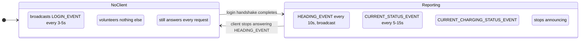

# Device behaviour

What an EVSEMaster-protocol charger does on the wire, independent of any client. Frame and
payload layouts are in `protocol.md`.

## Two independent things

Chargers behave as if these were one thing, and they are not.

**Authorisation is per packet.** The password sits at bytes 13–19 of every frame. There is no handshake that unlocks anything: each packet is authorised on its own. 
A client that never sent a login gets `NICKNAME_EVENT` and `OUTPUT_AMPERAGE_EVENT` answered; the same requests with a wrong password get `PASSWORD_ERROR_EVENT`.

**Commands therefore always work**, whatever the registration below is doing. A charge
start or stop is accepted and acted on by a charger that is sending no telemetry at all.

**The client registration is separate.** It decides *whether* the charger sends
`HEADING_EVENT`, `CURRENT_STATUS_EVENT` and `CURRENT_CHARGING_STATUS_EVENT`, not *where*:
everything the charger sends is broadcast. It is charger-side state, it can be lost, and losing it changes nothing about whether commands are accepted.

## The client registration

The two modes are sharply separated. A charger that has a client announces essentially never; one without a client announces every few seconds and sends nothing else. 
A single announcement means little, but a **sustained announcement beat means the charger has no client.**

**A second client does not displace the first.** While the vendor app was connected to an EC311S, the integration
kept its registration, but heading gaps reached 30 s instead of 10.

## The keepalive contract

`HEADING_EVENT` (0x0003) is the heartbeat that holds the registration open, and the most
important behaviour here:

- The charger sends it roughly every 10 seconds, **only while it holds a registration**.
  It is broadcast to 255.255.255.255:28376(captured on an EC311S).
- The client must answer `HEADING_RESPONSE` (0x8003).
- **If the client stops answering, the charger drops the registration** and reverts to announcing.

A client that stops receiving headings for longer than one interval should assume it has been dropped and log in again, rather than wait for a long timeout. 
Because headings are emitted only while a registration is held, their arrival - not traffic in general - is what proves it is alive.
Replies to requests the client itself sent prove only reachability.

What causes a charger to drop a registration in practice is not established. we need to simply detect it quickly and log in again.

## Login handshake

1. Client sends `LOGIN_REQUEST` (0x8002).
2. Charger answers `LOGIN_SUCCESS_EVENT` (0x0002) with its device description, or
   `PASSWORD_ERROR_EVENT` (0x0155).
3. Client sends `LOGIN_CONFIRM_RESPONSE` (0x8001), completing the handshake.
4. The charger begins reporting. The first status can take a few seconds.

`LOGIN_EVENT` (0x0001) carries the same device-description payload as
`LOGIN_SUCCESS_EVENT`, but it is the unsolicited broadcast announcement, not a reply.

The send port differs per unit and per firmware, and must always be learned from the
source address of incoming packets rather than assumed. Observed: Telestar EC311S 21937,
BS20 30139, Ocular 46540. A first request sent to a guessed port commonly goes unanswered;
by the retry, an inbound broadcast has usually revealed the real one.

## What the client must answer

| Charger sends | Client must send | Consequence of silence |
|---|---|---|
| `HEADING_EVENT` 0x0003 | `HEADING_RESPONSE` 0x8003 | registration dropped |
| `CURRENT_STATUS_EVENT` 0x0004 | `CURRENT_STATUS_RESPONSE` 0x8004 | - |
| `LOGIN_SUCCESS_EVENT` 0x0002 | `LOGIN_CONFIRM_RESPONSE` 0x8001 | handshake never completes |
| `CURRENT_CHARGING_STATUS_EVENT` 0x0005 | `CURRENT_CHARGING_STATUS_RESPONSE` 0x8005, payload `[0x00]` | unknown |
| `CURRENT_CHARGE_RECORD_EVENT` 0x0009 | 0x8009, charge id acknowledgement | unknown |
| `UPLOAD_LOCAL_CHARGE_RECORD` 0x000A | 0x800A, charge id acknowledgement | record is rebroadcast forever |

**The charger always answers to port 28376, never to the source port of the request.** A
client that sends from any other port gets no reply at all, however well-formed the query.
This is why every implementation binds 28376 specifically.

The reason is that **the charger broadcasts every frame** to 255.255.255.255:28376 and never addresses a client.

Two further properties of this frame, both confirmed by measurement:

- **The passphrase is returned in plaintext.** Anything that logs or reports a raw 0x010A
  frame leaks the network's Wi-Fi credentials.
- **Device-to-client frames fill the six password bytes with `0xFF`**, and those bytes count toward the checksum.

## Charging records

When a session ends the charger uploads a record and **keeps rebroadcasting it until an app acknowledges it**. A charger that has never been acknowledged holds a backlog and replays it continuously - one record every few seconds, indefinitely.

This does not affect the registration; an EC311S with over a hundred unacknowledged records reports telemetry normally.

**Acknowledging takes a record out of the replay, not out of history.** The charger keeps its last 300 sessions in a
ring that 0x800B/0x800C read, acknowledged or not. The vendor app, though, builds its history only from records it
acknowledges itself and never reads the charger's. A client that acknowledges records therefore hides those sessions
from the vendor app.

## Timings

Measured on a Telestar EC311S over 20.7 hours registered, cross-checked against
[emproto](https://github.com/johnwoo-nl/emproto).

| Behaviour | Measured | Reported elsewhere |
|---|---|---|
| `HEADING_EVENT` interval | 10.09s, ~100% delivered | 10s (emproto) |
| `CURRENT_STATUS_EVENT` interval | 15.1s median, 31s worst | 5–10s (emproto) |
| `CURRENT_CHARGING_STATUS_EVENT` interval | ~13s | - |
| `LOGIN_EVENT` with no client | every 3.0s | ~5s (emproto) |
| `LOGIN_EVENT` while registered | 2 in 20.7h | - |
| Charge record replay | every 3.6–6s | - |
| Registration considered lost after | - | 15s without a heading (emproto) |
| Device considered offline after | - | 11s (emproto)|

Status cadence is firmware-dependent; treat 5–15s as the range and the heading beat as the reliable clock.

## Per-model quirks

- **Amperage changes mid-charge.** A Telestar EC311S applies the output amperage only when
  a charge *starts*. It echoes a mid-session change back within seconds and then ignores
  it: the same 16 A limit measured 9.3 A when set mid-session and 15.3 A when the session
  was restarted with it. Lowering additionally faults minutes later. A BS20 accepts changes
  mid-charge, but interrupts charging for roughly twenty seconds to do so.
- **Reservations without a car.** A pending reservation reports `CHARGING_RESERVATION` even
  with nothing plugged in, so `NOT_CONNECTED` means nothing is scheduled.
- **Reported power is per phase.** On a three-phase charger the power field carries one
  phase only; summing the measured phases is correct on both single and three phase.
- **Payload sizes vary.** Single-phase chargers send 25-byte status payloads with no L2/L3
  block against 33 for three-phase. An EC311S sends 33 with L2/L3 at 0 when only L1 is live.
  Status also arrives as 0x000D and charging status as 0x0006: the replies to the on-demand
  requests 0x800D and 0x8006, not firmware variants. The charger ignores 0x0004 sent as a request.
- **A charge starts in three steps, not one.** Measured on an EC311S: the current state moves to 14 (charging)
  while the plug is still 2 (unlocked) and the output still 2 (off); the plug then locks to 4; only then does the
  output turn on to 1. Stopping unwinds the same way, and the output stays on for one status packet after the state
  has already moved to 15 (completed). Anything deriving "is charging" from a single field will disagree with the
  others for a few seconds around both edges.
- **Unmapped enum values are normal.** A BS20 reports plug state 16. Firmware reports values
  no client has mapped, and one unknown byte must not cost the whole packet.